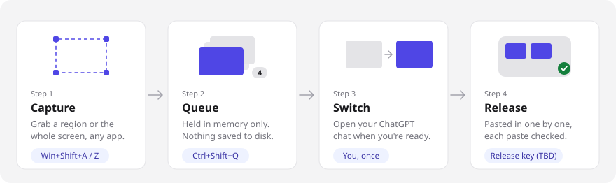
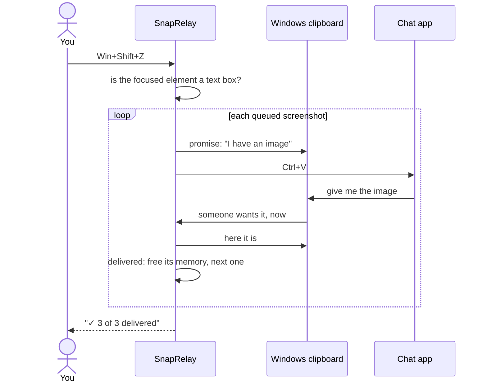
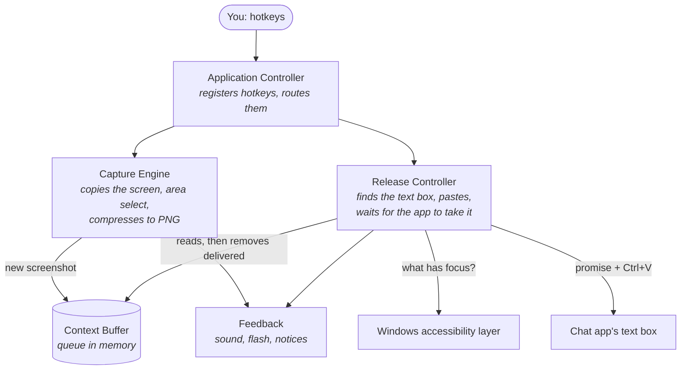

# SnapRelay

**Capture anywhere. Queue for a moment. Release into your AI chat.**

SnapRelay is a small Windows utility for people who work with AI chat apps all day. Take screenshots from any app with a hotkey, let them pile up in a queue, then send them all into your chat at once. No switching back and forth after every screenshot.

> **v0.1.0, first release.** Capture, the queue window and release into a chat box work in ChatGPT, Claude, WhatsApp and VS Code, with no app-specific code. SnapRelay lives in the tray: about 15 MB of memory when idle, and the program itself is under 1 MB. The original design is in [`docs.txt`](docs.txt) (working title there: *Visual Context Bridge*).

  

---

## The problem

Today, sharing what's on your screen with an AI chat looks like this, once per screenshot:

1. Take a screenshot.
2. Switch to the chat app.
3. Paste it.
4. Switch back to what you were doing.

With five screenshots, that's five round trips. SnapRelay turns it into one: capture as many as you like while you work, switch to the chat once, and release them together.

## Install

Download from the [latest release](https://github.com/M-uzamilAli/SnapRelay/releases/latest) (Windows 10/11, 64-bit):

- **`SnapRelay-Setup-0.1.0.exe`**: installs for your user only (no admin), adds a Start menu entry and, if you leave the box ticked, starts with Windows. Uninstall from *Settings > Apps*.
- **`SnapRelay-0.1.0-portable.zip`**: unzip anywhere and run `snaprelay.exe`. Nothing is installed.

The files aren't code-signed yet, so the first time Windows may say *"Windows protected your PC"*: click **More info > Run anyway**.

## Use it

1. Press **Win+Shift+D** for the whole screen, or **Win+Shift+X** and drag a box. You hear a short click, the area flashes, and a notice says *"Captured · 3 queued"*. Keep working; screenshots wait in the queue.
2. Click into the chat's message box (ChatGPT, Claude, WhatsApp, …).
3. Press **Win+Shift+Z**. Everything ticked lands in the chat, in order.

Press **Win+Shift+Q** to see the queue first: untick what you don't want to send, drag rows to change the order, remove one with ✕. Each row shows *Sending… / ✓ Sent / Not sent* while it goes out.

## Shortcuts

| Shortcut | What it does |
|---|---|
| `Win + Shift + D` | Capture the whole monitor under the mouse |
| `Win + Shift + X` | Capture an area: the screen freezes and dims, drag a box. Esc, right-click or the same shortcut again cancels |
| `Win + Shift + Z` | Paste the ticked screenshots into the text box you clicked into |
| `Win + Shift + Q` | Open or close the queue window |

All four can be changed in **Settings** (⚙ in the queue window, or right-click the tray icon > *Settings…*). Click a shortcut, press the new keys; if another program already owns that combination, SnapRelay says so and keeps the old one.

## Settings

Shortcuts, *Start with Windows*, capture sound and flash, the queue's memory limit (100 / 200 / 500 MB; a full queue refuses new captures rather than dropping any), and how long the queue window stays open when idle. Changes apply right away and are saved in `%APPDATA%\SnapRelay\settings.txt`.

**Recording mode** (tray menu) is for making demo videos: the shortcuts you press appear on screen, and SnapRelay's own windows become visible to screen recorders (normally they're hidden from every screen capture, so they never end up in your screenshots).

## How releasing works

SnapRelay never needs to know which chat app you're using. It only talks to Windows:

1. **Find the box.** It asks Windows' accessibility layer *"what has focus, and is it a text box?"*. Apps that hide their text box from Windows (WhatsApp shows up as an unnamed pane) are treated as *unknown*: SnapRelay tries, and step 3 tells it whether that worked.
2. **Offer the image.** Instead of putting the image on the clipboard, it puts a *promise* there (*"ask me when you need it"*), then presses Ctrl+V.
3. **Wait for the app to take it.** When the app pastes, Windows asks SnapRelay for the image. That request is the signal that the paste landed, usually 10–300 ms later, so SnapRelay moves straight on to the next one. There's no fixed waiting.
4. **Never lose a screenshot.** If the app doesn't take it, SnapRelay presses Ctrl+V again (up to 3 tries; this can't create duplicates, because an app can only get the image by asking SnapRelay). If it still isn't taken, the screenshot stays queued and the notice tells you.

Delivered screenshots are removed from memory right away; only the ones still waiting stay queued. Screenshots are kept out of Windows' clipboard history (Win+V) and never touch the disk.

## How it's built

One small Rust program in the tray. The main parts, each with one job:

| Part | Where it lives |
|---|---|
| Application Controller | `src/main.rs` |
| Capture Engine | `src/capture.rs`, `src/select.rs` (area selection) |
| Context Buffer | `src/buffer.rs` |
| Release Controller | `src/release.rs`, `src/clipboard.rs` (the clipboard promise) |
| Feedback | `src/feedback.rs` (sound, flash), `src/notice.rs` (on-screen notices) |
| Queue window + Settings panel | `src/queue.rs`, `src/settings_ui.rs` |
| Settings and shortcuts | `src/settings.rs` (saved settings), `src/hotkeys.rs` (registers and changes shortcuts) |
| Tray icon | `src/tray.rs` |

## Things learned along the way

- **Chat boxes aren't Windows controls.** In Chrome-based apps the message box is drawn by the app; Windows only knows about it because the app *describes* it through the accessibility layer. That shared description, not a shared component, is what makes one generic paste work everywhere.
- **No Alt in the paste shortcut.** SnapRelay swallows the letter, so the app sees a lone Alt press and jumps to its menu bar, stealing focus from the text box.
- **Other programs read your clipboard.** Clipboard sync tools (WSL's `msrdc.exe`, PowerToys Mouse Without Borders) grab every new item. SnapRelay ignores their reads, lets them finish, and only counts the chat app taking the image.

## Roadmap

- [x] **Capture**: hotkeys, whole screen, area selection, PNG compression, sound + flash
- [x] **Queue in memory**: store, free each screenshot once delivered, memory limit
- [x] **Release**: clipboard promise, wait for the app to take each image, retries, never lose a screenshot
- [x] **Queue window**: previews, tick what to send, drag to reorder, live status, remove, clear
- [x] **Tray icon, Settings, installer**
- [ ] Faster capture with Windows Graphics Capture
- [ ] Code-signed releases

## Build from source

Needs [Rust](https://rustup.rs) (with the Visual Studio C++ build tools). `cargo run` starts it with a console that logs what it does. `installer\build.ps1` builds the installer and the portable zip into `dist\` (needs [Inno Setup 6](https://jrsoftware.org/isinfo.php)).

## License

[MIT](LICENSE). The built-in [Inter](https://rsms.me/inter/) font is under the SIL Open Font License ([`assets/fonts/Inter-LICENSE.txt`](assets/fonts/Inter-LICENSE.txt)).

## Tech

Rust · Windows 10/11 · [`windows`](https://crates.io/crates/windows) crate for Windows APIs · [`png`](https://crates.io/crates/png) for compression · Windows UI Automation (accessibility layer) to find the text box · delayed-rendering clipboard for the delivery signal.
