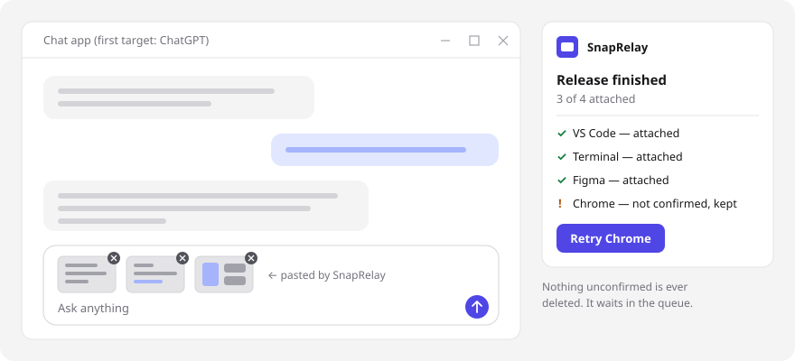
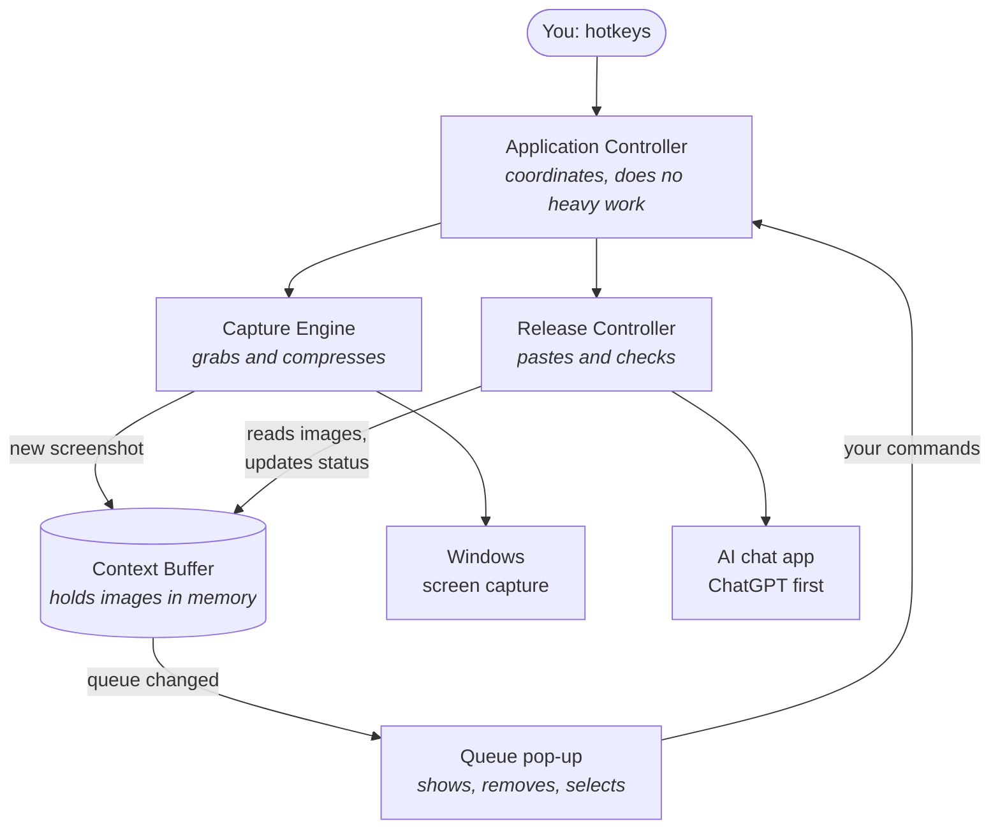
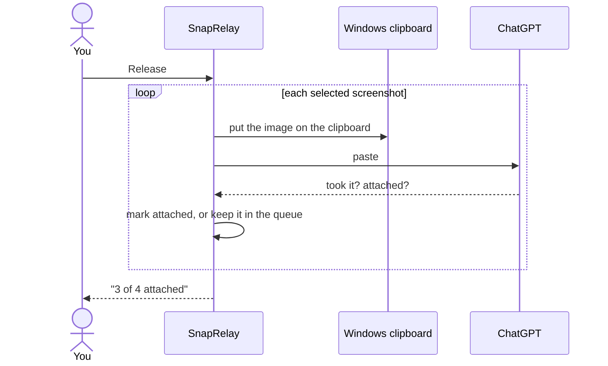

# SnapRelay

**Capture anywhere. Queue for a moment. Release into your AI chat.**

SnapRelay is a small Windows utility for people who work with AI chat apps all day. Take screenshots from any app with a hotkey, let them pile up in a queue, then send them all into your ChatGPT conversation at once — no switching back and forth after every screenshot.

> **Status: design stage.** There is no code yet. The pictures below are mockups of the intended app, not screenshots of a working one. The full design is in [`docs.txt`](docs.txt) (working title there: *Visual Context Bridge*).

  

---

## The problem

Today, sharing what's on your screen with an AI chat looks like this, once per screenshot:

1. Take a screenshot.
2. Switch to the chat app.
3. Paste it.
4. Switch back to what you were doing.

With five screenshots, that's five round trips. SnapRelay turns it into one: capture as many as you like while you work, switch to the chat once, and release them together.

## What it looks like

### The queue pop-up

Everything you've captured waits in a small pop-up that opens from the Windows tray (the icons near the clock).

  

### Releasing into the chat

SnapRelay pastes the screenshots into the chat's message box one at a time and checks each paste. Anything it can't confirm stays in the queue so you can retry it. Nothing is lost silently.

  

## Shortcuts

| Shortcut | What it does |
|---|---|
| `Win + Shift + A` | Capture a region you select |
| `Win + Shift + Z` | Quick capture of the whole screen |
| `Ctrl + Shift + Q` | Open the queue pop-up |
| *to be decided* | Release the queue into the chat |

## How it's built

One small Rust program that runs in the background. Screenshots are kept in memory only and never written to disk. It has five parts, each with one job:

What happens when you release:

## Scope of the first version

**In:** region and quick capture · in-memory queue · queue pop-up with remove and clear · release into one chat app (ChatGPT), one paste at a time · a status for every screenshot · measuring CPU and memory use.

**Out for now:** OCR · editing or annotating · cloud sync · saved history · several chat apps at once.

## Roadmap

- [ ] **1. Capture prototype** — hotkeys, region selection, screen capture, compression
- [ ] **2. Queue in memory** — store, remove, clear, enforce a size limit
- [ ] **3. Queue pop-up** — thumbnails, count, remove, clear all
- [ ] **4. Release** — clipboard, paste, check each paste, keep failures
- [ ] **5. End-to-end check** — real workflow, reliability, CPU and memory

## Tech

Rust · Windows 10/11 · `windows-rs` for Windows APIs · Windows Graphics Capture for screenshots · `egui` for the pop-up (first choice) · native Windows clipboard.
