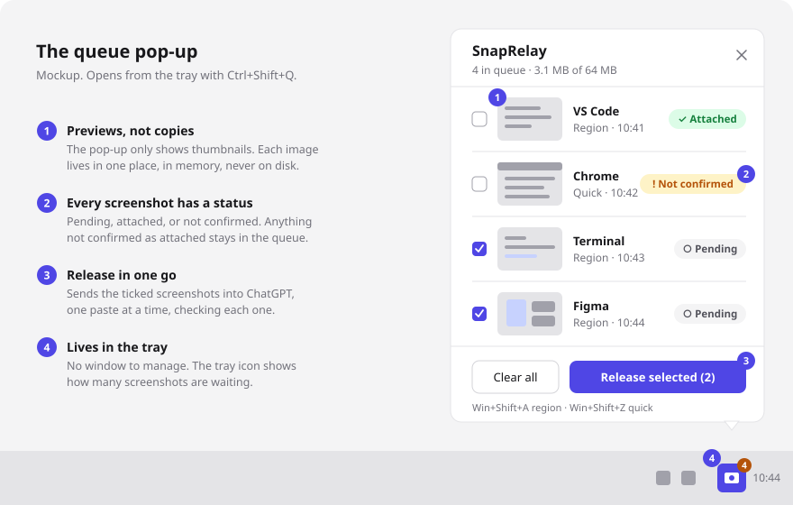

# SnapRelay

**Capture anywhere. Queue for a moment. Release into your AI chat.**

SnapRelay is a small Windows utility for people who work with AI chat apps all day. Take screenshots from any app with a hotkey, let them pile up in a queue, then send them all into your chat at once. No switching back and forth after every screenshot.

> **Status: working prototype.** Capture, the in-memory queue and release into a chat box work today, in ChatGPT, Claude, WhatsApp and VS Code, with no app-specific code. There is no queue window yet: the app runs in a console that logs what it does, and shows small on-screen notices. The original design is in [`docs.txt`](docs.txt) (working title there: *Visual Context Bridge*).

<p align="center">
  
</p>

---

## The problem

Today, sharing what's on your screen with an AI chat looks like this, once per screenshot:

1. Take a screenshot.
2. Switch to the chat app.
3. Paste it.
4. Switch back to what you were doing.

With five screenshots, that's five round trips. SnapRelay turns it into one: capture as many as you like while you work, switch to the chat once, and release them together.

## Try it

Needs Windows 10/11 and [Rust](https://rustup.rs) (with the Visual Studio C++ build tools).

```powershell
cargo run
```

Then:

1. Press **Win+Shift+A** and drag a box, or **Win+Shift+Z** for the whole screen. You hear a short shutter sound, the area flashes, and a notice says *"Captured · 3 in queue"*.
2. Click into the chat's message box (ChatGPT, Claude, WhatsApp, …).
3. Press **Win+Shift+V**. The notice counts *"Sending 2 of 3…"* and ends with *"✓ 3 of 3 delivered"*.

## Shortcuts

| Shortcut | What it does | If it's taken |
|---|---|---|
| `Win + Shift + A` | Capture an area: the screen freezes and dims, drag a box, Esc or right-click cancels | falls back to `Ctrl + Alt + Shift + A` |
| `Win + Shift + Z` | Capture the whole monitor under the mouse | falls back to `Ctrl + Alt + Shift + Z` |
| `Win + Shift + V` | Paste the queue into the text box you clicked into | falls back to `Win + Shift + X` |
| `Win + Shift + Q` | Open the queue window | *not built yet* |

Windows gives each shortcut to whichever program claims it first. If another tool (PowerToys, AutoHotkey, …) already owns one, SnapRelay uses the fallback and says so at startup. Free the key in that tool and restart SnapRelay to get it back.

## How releasing works

SnapRelay never needs to know which chat app you're using. It only talks to Windows:

1. **Find the box.** It asks Windows' accessibility layer *"what has focus, and is it a text box?"*. Apps that hide their text box from Windows (WhatsApp shows up as an unnamed pane) are treated as *unknown*: SnapRelay tries, and step 3 tells it whether that worked.
2. **Offer the image.** Instead of putting the image on the clipboard, it puts a *promise* there (*"ask me when you need it"*), then presses Ctrl+V.
3. **Wait for the app to take it.** When the app pastes, Windows asks SnapRelay for the image. That request is the signal that the paste landed, usually 10–300 ms later, so SnapRelay moves straight on to the next one. There's no fixed waiting.
4. **Never lose a screenshot.** If the app doesn't take it, SnapRelay presses Ctrl+V again (up to 3 tries; this can't create duplicates, because an app can only get the image by asking SnapRelay). If it still isn't taken, the screenshot stays queued and the notice tells you.


Delivered screenshots are removed from memory right away; only the ones still waiting stay queued. Screenshots are kept out of Windows' clipboard history (Win+V) and never touch the disk.

## How it's built

One small Rust program running in the background, with five parts, each with one job:


| Part | Where it lives |
|---|---|
| Application Controller | `src/main.rs` |
| Capture Engine | `src/capture.rs`, `src/select.rs` (area selection) |
| Context Buffer | `src/buffer.rs` |
| Release Controller | `src/release.rs`, `src/clipboard.rs` (the clipboard promise) |
| Feedback | `src/feedback.rs` (sound, flash), `src/notice.rs` (on-screen notices) |

## Things learned along the way

- **Chat boxes aren't Windows controls.** In Chrome-based apps the message box is drawn by the app; Windows only knows about it because the app *describes* it through the accessibility layer. That shared description, not a shared component, is what makes one generic paste work everywhere.
- **No Alt in the paste shortcut.** SnapRelay swallows the letter, so the app sees a lone Alt press and jumps to its menu bar, stealing focus from the text box.
- **Other programs read your clipboard.** Clipboard sync tools (WSL's `msrdc.exe`, PowerToys Mouse Without Borders) grab every new item. SnapRelay ignores their reads, lets them finish, and only counts the chat app taking the image.

## The queue window (next)

The plan for **Win+Shift+Q**: a small pop-up from the tray to see what's queued, remove single screenshots, clear everything, and pick what to send. *This picture is still a mockup.*

<p align="center">
  
</p>

## Roadmap

- [x] **1. Capture**: hotkeys, whole screen, area selection, PNG compression, sound + flash
- [x] **2. Queue in memory**: store, free each screenshot once delivered
- [x] **4. Release**: clipboard promise, wait for the app to take each image, retries, never lose a screenshot
- [x] On-screen notices for capture and release
- [ ] **3. Queue window** (Win+Shift+Q): thumbnails, remove, clear all, select
- [ ] Tray icon instead of a console window
- [ ] Memory limit for the queue
- [ ] Faster capture with Windows Graphics Capture

## Tech

Rust · Windows 10/11 · [`windows`](https://crates.io/crates/windows) crate for Windows APIs · [`png`](https://crates.io/crates/png) for compression · Windows UI Automation (accessibility layer) to find the text box · delayed-rendering clipboard for the delivery signal.
